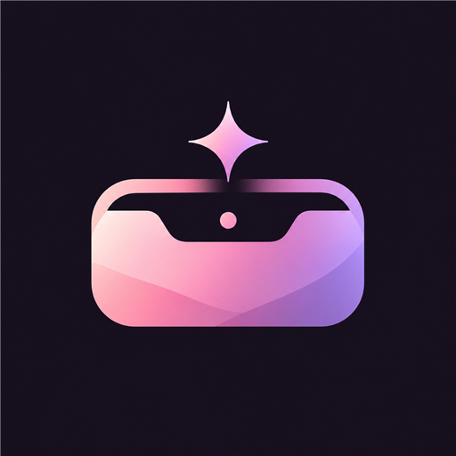

<div align="center">
  

  <h1>MangNotch 「 マン・ノッチ 」</h1>

  <p>
    <strong>Interactive Living Notch &amp; Desktop Companion for Windows</strong><br/>
    Inspired by the <em>MangNime Dusk</em> aesthetic, powered by Rust, Tauri v2, and the native Win32 API.
  </p>

  <p>
    <a href="https://github.com/MANG-CODER/MangNotch/releases/latest">
      
    </a>
    <a href="https://mangnotch.vercel.app/">
      
    </a>
    
    
  </p>
</div>

---

## ✨ About MangNotch

**MangNotch** transforms the top edge of your Windows 10 or Windows 11 screen into a living, interactive desktop companion.

Designed to run in the background and managed through the Windows **System Tray**, MangNotch brings media controls, synchronized lyrics, quick file access, and productivity tools together in a customizable desktop experience inspired by the **MangNime Dusk** aesthetic.

From checking your currently playing music to managing daily tasks, tracking water intake, or starting a Pomodoro session, MangNotch keeps useful tools close at hand without requiring a separate application window for every activity.

🌐 **Try the Interactive Browser Simulator:** [mangnotch.vercel.app](https://mangnotch.vercel.app/)

---

## 🚀 Key Features

### 🎵 Media Controls & Synchronized Lyrics

- Detects currently playing media through Windows media session integration.
- Supports media playback from compatible applications, including Spotify and supported browser media.
- Displays synchronized lyrics using LRCLIB when matching lyrics are available.
- Extracts colors from album artwork for a more dynamic visual experience.
- Provides dedicated music and live lyrics modes.

### 🎶 Compact Idle Lyrics

When using lyrics mode, the Notch can collapse into a compact lyrics bar when the cursor moves away, keeping the track title, album artwork, and lyrics within a smaller footprint.

### 🧠 Smart Proximity

Smart Proximity helps prevent the Notch from interfering with browser tabs and nearby window controls. When an overlapping area is detected, the Notch can shrink to a slim line so underlying interface elements remain accessible.

### 📂 Native File Shelf

Keep frequently used files close at hand with the integrated File Shelf.

- Drag files from Windows Explorer into the Shelf.
- Select and manage items stored in the Shelf.
- Open files directly from the interface.
- Drag files out to supported applications and workflows.

### 🍅 Pomodoro & Focus Sessions

Manage focused work sessions with the built-in Pomodoro timer.

- Configure focus and short-break durations.
- Use integrated sound feedback, including rain sound options.
- Customize the experience to suit your workflow.

### 💧 Water Tracker

Track your daily water intake directly from the Notch.

- Configure your daily hydration goal.
- Set the amount recorded per cup.
- Customize reminder intervals.
- Monitor your progress through the water tank visualization.

### ✅ TodoList

Keep daily tasks accessible without opening a separate task manager.

- Add, complete, and delete tasks.
- Choose between supported list layouts.
- View task completion progress.
- Improved text handling helps accommodate longer task names.

### 🖥️ System Peek

Access system-related information through the System Peek mode, keeping useful desktop information available from the Notch.

### 🐾 Customizable Mascots & Themes

Personalize the appearance of your desktop companion.

**Mascots**
- MangCat — Cyber-Neko
- Mochi - Cute Blob
- Kitsune — Spirit Orbs

**Color Themes**
- MangNime Dusk
- Matcha Emerald
- Racing Red
- Sunset
- Ice Blue
- etc

### ⚙️ Control Center

Manage MangNotch preferences through its dedicated Control Center.

- **English language support** for the Control Center.
- Configure supported appearance and interaction settings.
- Choose the monitor used by the Notch.
- Configure startup behavior and fullscreen hiding.
- Adjust supported productivity settings, including Pomodoro and Water Tracker preferences.

### 🪟 Windows Integration

- Runs in the background and is accessible through the Windows System Tray.
- Supports configurable startup behavior.
- Includes fullscreen auto-hide behavior.
- Built with Rust, Tauri v2, and native Windows APIs.

---

## 🌐 Language Support

MangNotch v1.3.0 introduces **English language support in the Control Center**, making its settings more accessible to English-speaking users.

---

## 📦 Installation

### Option 1: Microsoft Store

Install MangNotch through the [Microsoft Store](https://apps.microsoft.com/) if the listing is available in your region.

If you already installed MangNotch from the Store, check your Store Library for available updates.

### Option 2: GitHub Releases

1. Open the [latest MangNotch release](https://github.com/MANG-CODER/MangNotch/releases/latest).
2. Download the installer that matches your preferred installation method.
3. Run the installer and follow the on-screen instructions.
4. Once launched, access MangNotch settings through the Windows System Tray.

Available release assets may include:
- **NSIS installer** (`.exe`)
- **Windows Installer package** (`.msi`)
- **MSIX package** (`.msix`), when provided in the release

For existing installations, use the same distribution channel whenever possible to update MangNotch.

---

## 🛠️ Build from Source

### Requirements

Make sure the following tools are installed:

- Node.js and npm
- Rust with `rustup`
- C++ Build Tools for Visual Studio
- The Windows development components required by Tauri

### Setup

```bash
# 1. Clone the repository
git clone https://github.com/MANG-CODER/MangNotch.git
cd MangNotch

# 2. Install dependencies
npm install

# 3. Run in development mode
npm run tauri dev

# 4. Build the application and supported installers
npm run tauri build
```

Build output and available installer formats depend on the project's Tauri configuration and installed build tools.

---

## 🔒 Privacy & Security

MangNotch is designed to run locally on your Windows device.

For more information about its data handling practices, please review the [Privacy Policy](PRIVACY.md).

---

## 📝 Latest Release

**Current release: v1.3.0**

Highlights:
- Added English language support in the Control Center.
- Fixed an issue with the Notch address bar.
- Improved the naturalness of rain sounds in Pomodoro mode.
- Improved text length handling in TodoList.

For the complete release history and downloadable packages, visit [GitHub Releases](https://github.com/MANG-CODER/MangNotch/releases).

---

## 👤 Developer

Developed by **vestiapani** as part of the MangNime creative ecosystem.

🌐 **Website:** [mangnotch.vercel.app](https://mangnotch.vercel.app/)

💻 **GitHub:** [MANG-CODER/MangNotch](https://github.com/MANG-CODER/MangNotch)

---

<div align="center">
  <sub>Built with Rust, Tauri, and a little MangNime spirit.</sub>
</div>
