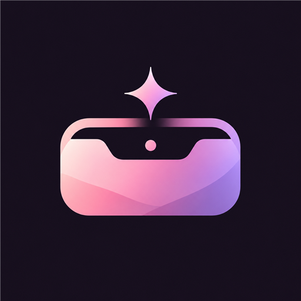

<div align="center">
  

  <h1>MangNotch 「 マン・ノッチ 」</h1>

  <p>
    <strong>Interactive Living Notch &amp; Desktop Companion for Windows</strong><br/>
    Inspired by the <em>MangNime Dusk</em> aesthetic, powered by Rust, Tauri v2, and native Win32 APIs.
  </p>

  <p>
    <a href="https://github.com/MANG-CODER/MangNotch/releases/latest">
      
    </a>
    <a href="https://mangnotch.vercel.app/">
      
    </a>
    
    
  </p>
</div>

---

## ✨ About MangNotch

**MangNotch** transforms the top edge of your Windows 10 or Windows 11 screen into a living, interactive desktop companion.

Designed to run lightly in the background and managed through the Windows **System Tray**, MangNotch brings media controls, synchronized lyrics, a built-in calendar, file shelf, system peeks, and productivity tools together in a customizable **Soft Light Glass** interface inspired by the **MangNime Dusk** aesthetic.

Now supporting **multi-monitor setups** with lower memory usage and **16 languages**, MangNotch keeps everyday tools close at hand across your desktop without getting in the way of your workflow.

🌐 **Try the Interactive Browser Simulator:** [mangnotch.vercel.app](https://mangnotch.vercel.app/)

---

## 🚀 Key Features

### 🖥️ Multi-Monitor Support & Smart Proximity

- **Multi-Display Ready** — Display MangNotch on your **Primary** monitor, **All** connected monitors, or a **Custom** selection of displays simultaneously.
- **Per-Monitor Smart Proximity** — Independently monitors each display using native Win32 hit-testing (`WM_NCHITTEST`) so empty browser titlebars keep your mascot visible, while crowded tab bars or centered toolbars automatically shrink the Notch into a slim line.
- **Accurate Fullscreen Auto-Hide** — Distinguishes normal maximized windows from true fullscreen games, `F11` browsers, and fullscreen videos independently on each monitor.
- **Global Hotkey (`Alt+N`)** — Toggle the Notch open or closed on whichever monitor your cursor is currently on.

### 📅 Calendar & Event Reminders *(New in v2.1.0)*

- Switch between a compact weekly strip and an expanded monthly grid with a quick month/year picker.
- **Inline Glass Time Picker** — Set exact event times by typing, scrolling, or using `−`/`+` steppers, complete with repeat options (Once, Daily, Weekly) and customizable reminder lead times (`On time`, `5m`, `10m`, `30m`).
- **Timezone-Aware Public Holidays** — Automatically detects local fixed-date public holidays from your OS timezone (independent of app language), plus manual region override for 20+ countries.
- **Reminder Peeks** — Shows Notch notifications with optional chimes before and at scheduled times.

### 🎵 Media Controls & Synchronized Lyrics

- Detects currently playing media via Windows media session integration (Spotify, browsers, and compatible desktop players).
- **Multi-Provider Lyrics Engine** — Uses **LRCLIB** as a reliable primary source and automatically upgrades to **word-by-word karaoke sync** via **YouLyPlus**, **PaxSenix**, and **NetEase** when available.
- **Shared Multi-Monitor Cache** — Fetches lyrics only once across all displays to save RAM and bandwidth while keeping seek positions and timing offsets (`±0.5s`) in sync.
- **Compact Idle Lyrics & Album Glow** — Extracts ambient colors from album artwork, supports pinned lyrics mode, and collapses into a compact live lyrics bar when idle.

### 📂 Celestial File Shelf

- Drag files directly from Windows Explorer into the Notch with a continuous **Celestial NameDrop** optical wave aura.
- Multi-select items, preview image thumbnails, open or reveal in Explorer, paste from clipboard, or drag files back out to other apps while preserving original file formats.

### 🍅 Pomodoro & Focus Sessions

- Built-in focus and short-break timer with circular progress ring, quick duration presets (`25/5`, `50/10`, `90/20`), auto-break toggle, chime feedback, and built-in ambient rain audio.

### 💧 Water Tracker

- Track daily hydration directly from the Notch with an animated water tank, customizable daily goal, cup size, reminder intervals, and automatic daily reset.

### ✅ To-Do List

- Add, complete, and delete daily tasks directly from the Notch with an embedded confirm (`✓`) button, horizontal/vertical scroll layouts, completion animations, and marquee scrolling for long task names.

### ⚡ 12 Native System Peeks

Non-intrusive status pop-ups powered by lightweight native Win32 APIs, each individually toggleable:

- **Volume & Mute** · **Display Brightness** · **Microphone Mute** · **Charging & Battery** · **Bluetooth Status** · **Caps Lock**
- **Num Lock** · **Keyboard Layout** · **Clipboard Copy** · **USB & Drives** · **Network Status** · **Low Battery Alert**

### 🐾 Mascots, Custom Themes & Soft Light Glass Control Center

- **Interactive Mascots:** MangCat (Cyber-Neko), Mochi (Cute Blob), and Kitsune (Spirit Orbs) that react to audio beats and system events.
- **Themes & Custom Color Palette:** Pick from built-in presets (*MangNime Dusk*, *Matcha Emerald*, *Racing Red*, *Sunset*, *Ice Blue*, and more) or create your own 3-color **Custom Palette** (Primary, Secondary, Accent).
- **Soft Light Glass Customizer:** Choose native Windows 11 DWM backdrop materials (**Acrylic**, **Mica**, **Mica Alt**, **Clear**) and fine-tune Control Center opacity, Notch opacity, component/button surfaces, glass specular rim, and Dynamic Island mode.

---

## 🌐 Language Support

MangNotch automatically detects your system language and supports **16 languages** across the Notch, Control Center, and System Tray:

`English` · `Bahasa Indonesia` · `日本語` · `한국어` · `简体中文` · `繁體中文` · `Español` · `Deutsch` · `Nederlands` · `Français` · `Русский` · `Bahasa Melayu` · `Filipino` · `ไทย` · `Tiếng Việt` · `हिन्दी`

---

## 📦 Installation

### Option 1: Microsoft Store

Install MangNotch through the [Microsoft Store](https://apps.microsoft.com/) if the listing is available in your region.

If you already installed MangNotch from the Store, check your Store Library for available updates.

### Option 2: GitHub Releases

1. Open the [latest MangNotch release](https://github.com/MANG-CODER/MangNotch/releases/latest).
2. Download the installer that matches your preferred installation method.
3. Run the installer and follow the on-screen instructions.
4. Once launched, access MangNotch settings through the Windows System Tray.

Available release assets include:
- **NSIS installer** (`.exe`)
- **Windows Installer package** (`.msi`)
- **MSIX package** (`.msix`)
- **SHA-256 Checksums** (`SHA256SUMS.txt`)

For existing installations, use the same distribution channel whenever possible to update MangNotch.

---

## 🛠️ Build from Source

### Requirements

- Node.js and npm
- Rust with `rustup`
- C++ Build Tools for Visual Studio
- Windows WebView2 & Tauri v2 development prerequisites

### Setup

```bash
# 1. Clone the repository
git clone [https://github.com/MANG-CODER/MangNotch.git](https://github.com/MANG-CODER/MangNotch.git)
cd MangNotch

# 2. Install dependencies
npm install

# 3. Run in development mode
npm run tauri dev

# 4. Build the application and installers
npm run tauri build
```

---

## 🔒 Privacy & Security

MangNotch is designed to run locally on your Windows device. Network requests are only used for fetching lyrics (when media is playing) and checking for app updates.

For full details, please review the [Privacy Policy](PRIVACY.md).

---

## 📝 Latest Release

**Current release: v2.1.0**

MangNotch v2.1.0 brings multi-monitor support, a brand-new Calendar & Reminders page, lower RAM usage, expanded 16-language localization, and deeper UI, Theme, and Soft Glass customization.

Highlights:
- **Multi-Monitor Support:** Run MangNotch across multiple monitors simultaneously (Primary, All, or Custom) with independent per-monitor Smart Proximity and fullscreen auto-hide.
- **New Calendar & Reminders Page:** Compact weekly strip & expanded monthly view, inline glass time picker, repeat schedules, event reminder peeks, and OS timezone-based holidays.
- **Refreshed UI, Custom Themes & Soft Glass:** Custom 3-Color Palette picker, native Windows 11 DWM backdrop materials (Acrylic, Mica, Mica Alt, Clear), streamlined Soft Glass controls, and zero-flicker transitions.
- **Expanded Localization (16 Languages):** Broadened full multi-language support across the Notch, Control Center, and System Tray.
- **12 Native System Peeks & Celestial File Shelf:** Added 6 new peek categories (Num Lock, Keyboard Layout, Clipboard, USB/Drives, Network, Low Battery) and a continuous Celestial NameDrop wave aura.
- **Lower RAM Usage & Bug Fixes:** Shared single-fetch lyrics cache across monitors, lightweight native Win32 polling, LRCLIB-first word-sync lyrics stability, and numerous UI/drag-drop fixes.

For the complete release history and downloadable packages, visit [GitHub Releases](https://github.com/MANG-CODER/MangNotch/releases).

---

## 👤 Developer

Developed by **vestiapani** as part of the MangNime creative ecosystem.

🌐 **Website:** [mangnotch.vercel.app](https://mangnotch.vercel.app/)

💻 **GitHub:** [MANG-CODER/MangNotch](https://github.com/MANG-CODER/MangNotch)

---

<div align="center">
  <sub>Built with Rust, Tauri, and a little MangNime spirit.</sub>
</div>